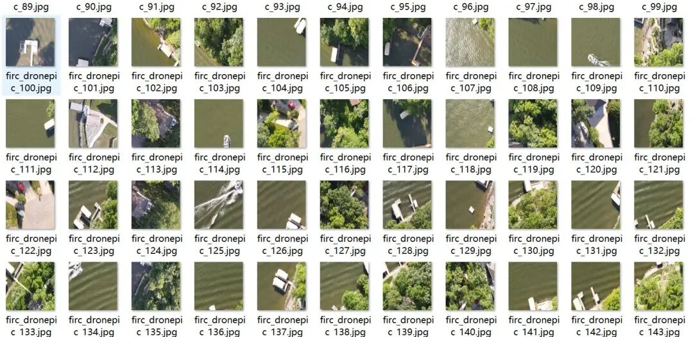
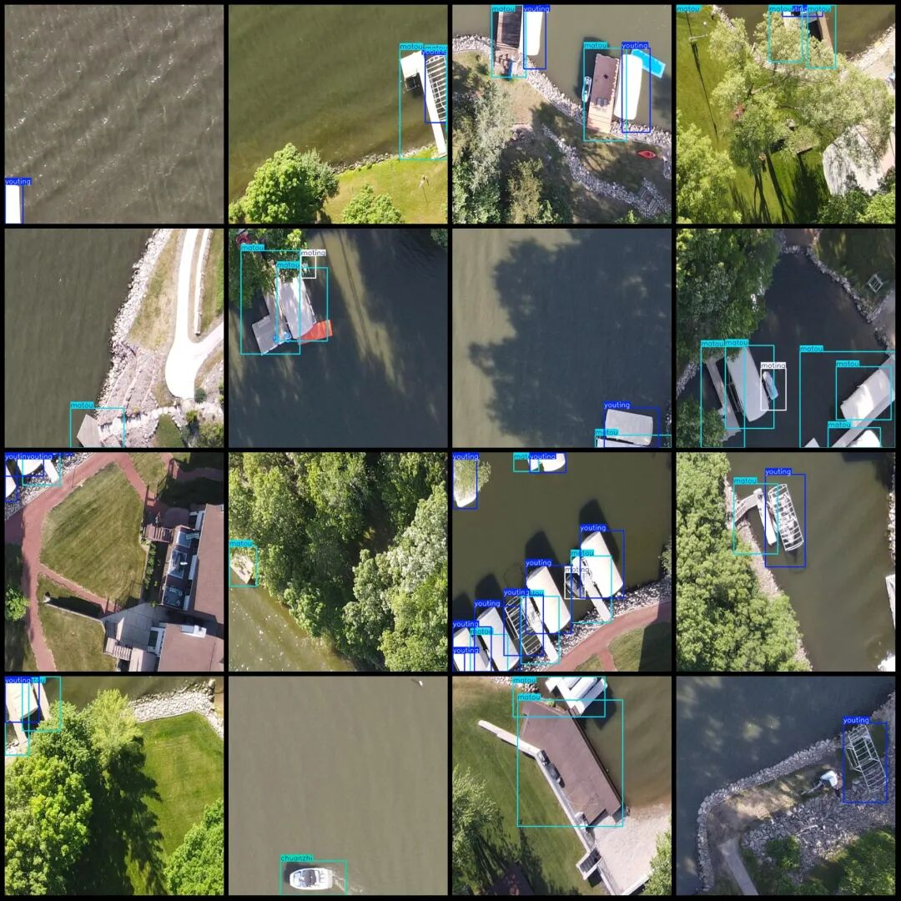

# Dataset of drone-viewed riverside land features detection in VOC+YOLO format with 5 categories, 508 images.

Dataset format: Pascal VOC format + YOLO format (txt file without split path, only containing jpg images and corresponding VOC format xml files and yolo format txt files)

Number of images (number of jpg files): 508

Number of annotations (number of xml files): 508

Number of annotations (number of txt files): 508

Label category count: 5

["chuanzhi", "matou", "moting", "qiche", "youting"] => ["ship", "dock", "motorboat", "car", "yacht"]

Number of boxes labeled in each category:

Chuanzhi Frame Count = 53

Number of matou boxes = 678

Number of moting frames = 146

Qiche frame count = 61

Youting Frames = 662

Total frame count: 1600

Using labelImg:

Annotation rules: Draw a rectangle around the category.

Important Notice: No

Special : This dataset does not guarantee the accuracy or precision of the trained models or weight files. The dataset is provided with accurate and reasonable annotations only.

Image Preview:

Annotation example:

## Payment

Here is a pay link on Stripe ( https://buy.stripe.com/3cs8yP7sY87d0vu9AB ). Please contact me lonlonago@foxmail.com after funding $89, and I will send you a complete data files , thank you!

